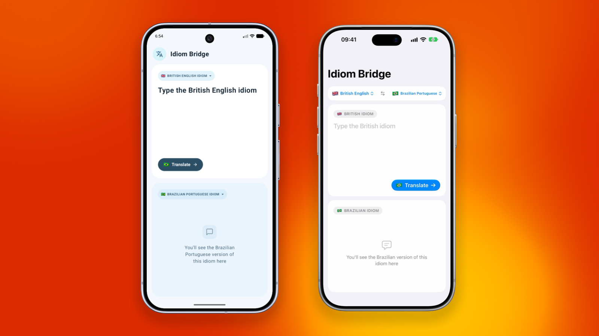

# Idiom Bridge - Firebase: The Agentic Way

Companion repository for **The Agentic Way** video series on the [Firebase YouTube channel](https://www.youtube.com/@Firebase), where we build **Idiom Bridge** (a cross-platform app for translating cultural idioms across British English, Brazilian Portuguese, Chilean Spanish, and German) using AI coding agents and Firebase.

## Video Series

| Episode | Topic | Status | Video |
| :--- | :--- | :--- | :--- |
| 1 | Gearing Up Your Coding Agent (Skills, Rules & Tooling) | Published | [Firebase on YouTube](https://www.youtube.com/@Firebase) |
| 2 | Firebase AI Logic (Gemini Idiom Translation + App Check) | Published | [Firebase on YouTube](https://www.youtube.com/@Firebase) |
| 3 | Firebase Authentication (Agentic Setup) | In Progress | TBD |
| 4 | Cloud Firestore (Syncing Idioms on iOS) | Upcoming | TBD |

> *Direct episode links will be added as each video goes live.*

## Repository Layout

- [`android/`](android/) - Kotlin & Jetpack Compose Android app
- [`apple/`](apple/) - Swift 6 & SwiftUI iOS 27 app (Xcode 27 JSON project + Liquid Glass UI)

## Getting Started

### Android
1. Open [`android/`](android/) in Android Studio.
2. Add your `google-services.json` to `android/app/` (gitignored).
3. Build and run on an emulator or device.

### Apple (iOS 27+)
1. Open [`apple/IdiomBridge.xcodeproj`](apple/IdiomBridge.xcodeproj) in Xcode 27+.
2. Add your `GoogleService-Info.plist` to `apple/IdiomBridge/` (gitignored).
3. Enable Firebase AI Logic (Gemini Developer API) in your Firebase project and run on the iOS 27+ simulator.
